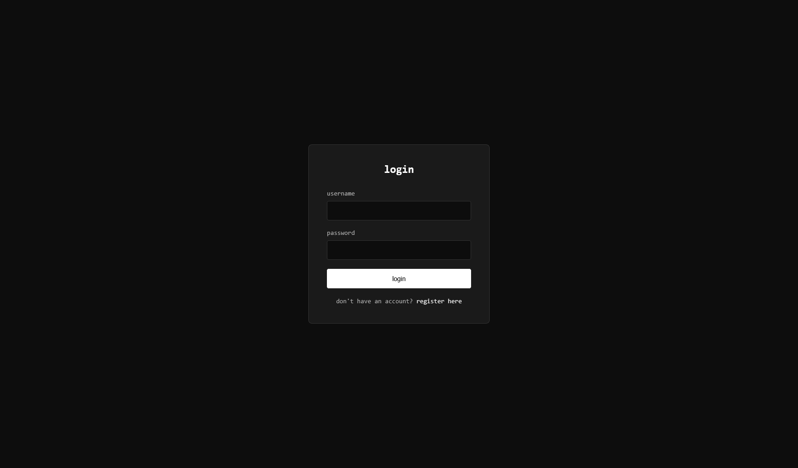

# notes-jsb

Web application for notes, with registration.

*(jsb - Java Spring Boot)*

## 📸 Screenshots

 

## 🚀 Quick start

### 1. Clone the repository
```bash
git clone https://github.com/010nn/notes-jsb.git
cd notes-jsb
```

### 2. Environment Variables Setup
Create a `.env` file in the root directory and configure your variables:
```env
DB_NAME=db
DB_USER=user
DB_PASSWORD=password
DB_PORT=5432

JAVA_PORT=8080
```

### 3. Run with Docker Compose
```bash
docker-compose up -d
```
The app will be up and running at: `http://localhost:8080` (or your custom `${JAVA_PORT}`)

## 🛠️ Tech Stack

- Java 17
- Spring Boot 3.2.0
- Spring Security
- Spring Data JPA
- Thymeleaf
- PostgreSQL
- Maven
- Docker Compose

## 📁 Project structure

```
notes-jsb/
├── src/
│   ├── main/
│   │   ├── java/com/notesjsb/
│   │   │   ├── NotesJSB.java              # Main application entry point
│   │   │   ├── config/
│   │   │   │   └── SecurityConfig.java    # Spring Security configuration
│   │   │   ├── controller/
│   │   │   │   ├── ApiController.java     # REST api endpoints controller
│   │   │   │   ├── AuthController.java    # Authentication & Registration controller
│   │   │   │   ├── GlobalExceptionHandler.java
│   │   │   │   └── NoteController.java    # Web UI notes controller
│   │   │   ├── model/
│   │   │   │   ├── dto/
│   │   │   │   │   └── NoteDto.java
│   │   │   │   ├── Note.java              # Note entity model
│   │   │   │   └── User.java              # User entity model
│   │   │   ├── repository/
│   │   │   │   ├── NoteRepository.java    # Notes database repository
│   │   │   │   └── UserRepository.java    # Users database repository
│   │   │   └── service/
│   │   │       ├── CustomUserDetailsService.java     # UserDetails service for Security
│   │   │       ├── NoteService.java       # Notes business logic service
│   │   │       └── UserService.java       # Users business logic service
│   │   └── resources/
│   │       ├── static/
│   │       │   ├── css/
│   │       │   │   └── style.css
│   │       │   └── js/
│   │       │       └── notes.js
│   │       ├── templates/
│   │       │   ├── login.html                     # Login page template
│   │       │   ├── notes.html                     # Main notes page template
│   │       │   └── register.html                  # Registration page template
│   │       ├── META-INF/
│   │       └── application.properties             # Spring boot application config
├── docker-compose.yml                             # PostgreSQL & App container orchestration
├── Dockerfile                                     # Multi-stage Docker build for Java app (Maven + JRE)
├── .env                                           # Local environment variables
└── pom.xml                                        # Project Maven dependencies
```
